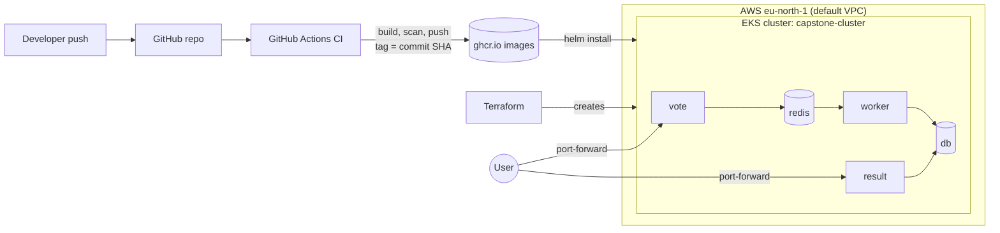

# Example Voting App: Ship It (Capstone 1)

A cloud-native voting app, containerised securely, built and scanned by CI, provisioned on AWS with Terraform and deployed to Kubernetes with Helm, including a tested rollback.

This is my fork of the Docker example voting app. The original app code is unchanged. The capstone work is the packaging, pipeline, infrastructure and deployment around it.

**Author:** Esther Jonathan (ProLaunch Careers x Afriment, Cohort 19, Cloud Computing Track, Team HACK)

---

## What the app does

Users pick **Cats** or **Dogs** on the vote page. The result page shows the live totals.

| Service  | Role                                         | Image / Tech                  |
|----------|----------------------------------------------|-------------------------------|
| `vote`   | Web page where users vote                    | Python (Flask)                |
| `redis`  | Queue that holds new votes                   | `redis:alpine`                |
| `worker` | Reads votes from Redis and writes to the DB  | .NET                          |
| `db`     | Stores the votes                             | `postgres:15-alpine`          |
| `result` | Web page that shows live results             | Node.js                       |

## Architecture



## Repository layout

```
.
├── vote/                    Vote service (Dockerfile hardened)
├── result/                  Result service (Dockerfile hardened)
├── worker/                  Worker service (Dockerfile hardened)
├── terraform/               EKS cluster on AWS
├── helm/voting-app/         Helm chart (Chart.yaml, values.yaml, templates/)
├── .github/workflows/ci.yml CI pipeline
└── docker-compose.yml       Local run
```

---

## 1. Run locally with Docker Compose

```bash
docker compose up --build
```

- Vote page: http://localhost:8080
- Result page: http://localhost:8081

## 2. Secure containers

Each of the `vote`, `result` and `worker` Dockerfiles was hardened:

- Base images are **pinned by digest**, so builds are reproducible.
- The final image runs as a **non-root user** (`appuser` for vote and worker, `node` for result).
- A `.dockerignore` keeps unneeded files out of the build context.

## 3. CI pipeline (GitHub Actions)

Workflow: `.github/workflows/ci.yml`

1. **Test**: a smoke test job checks the app starts.
2. **Scan**: Trivy scans each image (currently report-only, so it does not fail the build).
3. **Build and push**: images for `vote`, `result` and `worker` are built and pushed to GitHub Container Registry, **tagged with the full commit SHA** so every image can be traced to the exact code that produced it.

Published images (public):

```
ghcr.io/estherjonathan1/voting-app-vote:<commit-sha>
ghcr.io/estherjonathan1/voting-app-result:<commit-sha>
ghcr.io/estherjonathan1/voting-app-worker:<commit-sha>
```

## 4. Infrastructure with Terraform

The `terraform/` folder creates, in **eu-north-1 (Stockholm)** on the default VPC:

- An EKS cluster named `capstone-cluster`
- A managed node group `capstone-nodes` (one `m7i-flex.large` node)
- The IAM roles and policy attachments the cluster and nodes need

In total, **8 resources**.

```bash
cd terraform
terraform init
terraform apply        # about 10 to 15 minutes
terraform destroy      # run after each session to save credits
```

State files and `*.tfvars` are git-ignored. AWS credentials are never committed. They are configured locally with `aws configure`.

## 5. Deploy with Helm

The chart in `helm/voting-app/` deploys all five services (db, redis, vote, result, worker) with their Deployments and Services. Image repositories and tags are set in `values.yaml`.

```bash
# connect kubectl to the cluster
aws eks update-kubeconfig --region eu-north-1 --name capstone-cluster
kubectl get nodes

# install the chart
helm install voting helm/voting-app
kubectl get pods
kubectl get svc
```

All five pods reach `Running` with 0 restarts.

### Check the app

The services are `ClusterIP` (internal), so use port-forwarding:

```bash
kubectl port-forward svc/vote 8080:80 &
kubectl port-forward svc/result 8081:80 &
```

- Vote page: http://localhost:8080
- Result page: http://localhost:8081

Casting a vote on the vote page updates the result page, which confirms the whole chain works (vote, redis, worker, db, result).


## 6. Bad release and rollback demo

This shows that a broken release can be recovered quickly with Helm.

**Deploy a bad release** (an image tag that does not exist):

```bash
helm upgrade voting helm/voting-app --set vote.image.tag=does-not-exist
helm history voting
kubectl get pods
```

Result: Helm records revision 2 as `deployed`, but the new `vote` pod fails with `ImagePullBackOff`. The previous `vote` pod keeps running because Kubernetes only replaces it once the new pod is healthy, so users would see no downtime.

**Roll back:**

```bash
helm rollback voting 1
helm history voting
kubectl get pods
```

Result: Helm creates revision 3 ("Rollback to 1"), the broken pod is removed and all five pods are `Running` again.

| Revision | Status       | Description      |
|----------|--------------|------------------|
| 1        | superseded   | Install complete |
| 2        | superseded   | Upgrade complete (bad image tag) |
| 3        | deployed     | Rollback to 1    |


## 7. Clean up

```bash
kill %1 %2                # stop port-forwards
cd terraform
terraform destroy         # removes all 8 resources
```

`Destroy complete! Resources: 8 destroyed.` The cluster is destroyed after each work session, so no AWS charges keep running.

---

## Security notes

- Images are pinned by digest and run as non-root.
- Every pushed image is traceable to a commit through its SHA tag.
- No secrets or access keys are stored in the repo.
- The database credentials (`postgres` / `postgres`) are demo-only values hardcoded by the upstream app, and are documented as such in `values.yaml`.

## What I learned

- How to package a multi-service app securely and reproducibly.
- How a CI pipeline builds, scans and publishes traceable images.
- How to provision a Kubernetes cluster as code and tear it down to control cost.
- How Helm manages releases, and how `helm rollback` gives a fast, safe recovery from a bad deploy.
